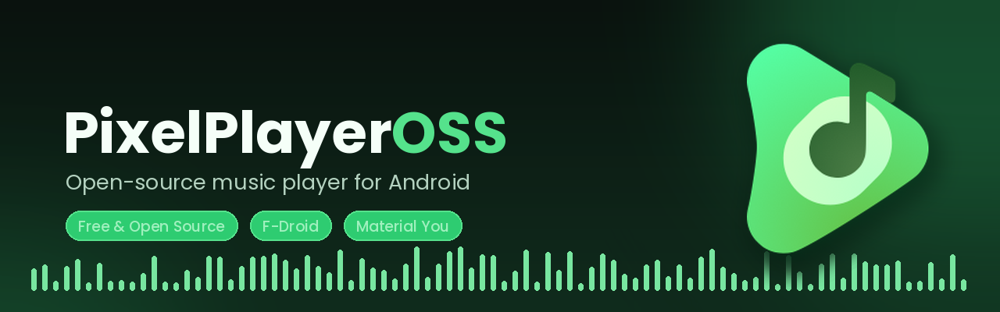

<p align="center">
<<<<<<< HEAD
  
</p>

<p align="center">
  <a href="https://github.com/MaterialMusicHQ/MaterialMusic/releases/latest">
    
  </a>
  <a href="https://f-droid.org/packages/com.material.music/">
    
  </a>
  <a href="https://github.com/MaterialMusicHQ/MaterialMusic/releases">
    
  </a>
  <a href="https://github.com/sponsors/lostf1sh">
    
=======
  
</p>

<p align="center">
  <a href="https://github.com/rebornlokii/MaterialMusic/releases/latest">
    
  </a>
  <a href="https://github.com/rebornlokii/MaterialMusic/releases">
    
>>>>>>> origin/main
  </a>
  
  
  
</p>

<p align="center">
<<<<<<< HEAD
  
  
  
  
=======
  
  
  
  
>>>>>>> origin/main
</p>

## What It Is

<<<<<<< HEAD
MaterialMusic is an Android music player maintained by [@lostf1sh](https://github.com/lostf1sh). It focuses on local playback, self-hosted music libraries, expressive Material 3 UI, and user-controlled online lookups.
=======
Material Music is an Android music player maintained by [@rebornlokii](https://github.com/rebornlokii). It is the rebranded continuation of [PixelPlayerOSS](https://github.com/lostf1sh/PixelPlayerOSS), the free and open-source version of the original PixelPlayer app by [@theovilardo](https://github.com/theovilardo). It focuses on local playback, self-hosted music libraries, expressive Material 3 UI, and user-controlled online lookups.
>>>>>>> origin/main

The app works offline by default. Optional online services are disabled until you enable them in setup or settings.

Package name: `com.material.music`

## Why This Exists

<<<<<<< HEAD
MaterialMusic keeps the player FOSS-oriented and removes integrations that are not part of that direction.
=======
Material Music keeps the player FOSS-oriented and removes integrations that are not part of that direction.
>>>>>>> origin/main

Removed integrations include Telegram, NetEase, QQ Music, Google Drive, Gemini, Cast, Wear OS, Play Store billing, Firebase, Crashlytics, and Google Play Services runtime dependencies.

Cloud playback is limited to self-hosted sources: Navidrome/Subsonic and Jellyfin.

## Features

| Area | Highlights |
| --- | --- |
| Playback | Media3 playback engine, FFmpeg support, gapless playback, crossfade, custom transitions, queue controls, shuffle, repeat, sleep timer, external file playback |
| Library | Local scanning for MP3, FLAC, AAC, OGG, WAV, M4A, albums, artists, genres, folders, favorites, playlists, stats, metadata editing |
| Self-hosted | Navidrome/Subsonic and Jellyfin login, sync, streaming, artwork, and app-private offline downloads |
| Lyrics | Embedded lyrics, local `.lrc` files, lyrics import/editing, optional LRCLIB lookup |
| Artwork | Local artwork, album-art palette extraction, optional Deezer artist image lookup |
| Metadata | On-demand MusicBrainz matching for recording, release, and artist identifiers |
| UI | Jetpack Compose, Material 3, dynamic color, light/dark themes, Glance widgets, animated player surfaces |
| Backup | Preferences, playlists, favorites, lyrics, stats, and app state backup/restore |

## Online Services

MaterialMusic separates offline playback from network lookups.

| Service | Purpose | Default |
| --- | --- | --- |
| Navidrome/Subsonic | Self-hosted library sync, streaming, and offline downloads | User login required |
| Jellyfin | Self-hosted library sync, streaming, and offline downloads | User login required |
| MusicBrainz | On-demand metadata matching and identifier enrichment | Only when requested |
| LRCLIB | Search online lyrics when local or embedded lyrics are missing | Off |
| Deezer | Fetch missing artist artwork and cache it locally | Off |

LRCLIB and Deezer can be enabled during first-run setup or later from `Settings > Music Management > Optional online services`. MusicBrainz searches run only when you choose the lookup action for a track.

## Requirements

| Requirement | Version |
| --- | --- |
| Android | 11 or newer, API 30+ |
| JDK | 21 |
| Android SDK | compile/target 37 |

## Build From Source

Clone the repository:

```sh
<<<<<<< HEAD
git clone https://github.com/MaterialMusicHQ/MaterialMusic.git
=======
git clone https://github.com/rebornlokii/MaterialMusic.git
>>>>>>> origin/main
cd MaterialMusic
```

Build the debug APK:

```sh
JAVA_HOME=/usr/lib/jvm/java-21-openjdk ./gradlew :app:assembleDebug
```

Build one universal debug APK for local installation:

```sh
JAVA_HOME=/usr/lib/jvm/java-21-openjdk ./gradlew :app:assembleDebug -Pmaterialmusic.enableAbiSplits=false
```

Build a universal unsigned release APK (no signing applied):

```sh
JAVA_HOME=/usr/lib/jvm/java-21-openjdk ./gradlew :app:assembleRelease -Pmaterialmusic.enableAbiSplits=false -Pmaterialmusic.disableReleaseSigning=true
```

Run unit tests:

```sh
JAVA_HOME=/usr/lib/jvm/java-21-openjdk ./gradlew :app:testDebugUnitTest
```

Generate the baseline profile with a connected device or emulator:

```sh
JAVA_HOME=/usr/lib/jvm/java-21-openjdk ./gradlew :baselineprofile:generateBaselineProfile
```

## Download

<<<<<<< HEAD
MaterialMusic is available on F-Droid:

<a href="https://f-droid.org/packages/com.material.music/">
  
</a>

GitHub releases are available at:

```text
https://github.com/MaterialMusicHQ/MaterialMusic/releases
```

Obtainium app id:

```text
com.material.music
=======
GitHub releases are available at:

```text
https://github.com/rebornlokii/MaterialMusic/releases
>>>>>>> origin/main
```

Public releases are planned on a regular weekly cadence when `main` passes the release checklist.

### Alpha builds

<<<<<<< HEAD
Every merge into `main` automatically publishes a pre-release tagged like `v0.3.0-alpha.N` on the [releases page](https://github.com/MaterialMusicHQ/MaterialMusic/releases). These are cutting-edge builds for testing new changes before they reach a stable release — expect rough edges.

To install one, download the APK for your device from the release assets and sideload it: `arm64-v8a` fits most modern devices, `armeabi-v7a` is for older 32-bit ones.

Alpha builds are signed with a dedicated CI key, so they update over each other, but switching between alpha and a stable or F-Droid install requires an uninstall/reinstall. In Obtainium, enable "Include prereleases" to get alphas automatically.

## Support

If MaterialMusic is useful to you, you can support ongoing development through [GitHub Sponsors](https://github.com/sponsors/lostf1sh).
=======
Every merge into `main` automatically publishes a pre-release tagged like `v0.2.0-alpha.N` on the [releases page](https://github.com/rebornlokii/MaterialMusic/releases). These are cutting-edge builds for testing new changes before they reach a stable release — expect rough edges.

To install one, download the APK for your device from the release assets and sideload it: `arm64-v8a` fits most modern devices, `armeabi-v7a` is for older 32-bit ones.

Alpha builds are signed with a dedicated CI key, so they update over each other, but switching between an alpha and a stable install requires an uninstall/reinstall.
>>>>>>> origin/main

## Project Structure

```text
app/src/main/java/com/material/music/
- data/             Room, repositories, preferences, services, workers
- di/               Hilt modules and qualifiers
- presentation/     Compose screens, components, navigation, ViewModels
- ui/               Theme and Glance widgets
- utils/            Shared utilities

baselineprofile/      Macrobenchmark and baseline profile generation
```

## Tech Stack

| Area | Technology |
| --- | --- |
| Language | Kotlin |
| UI | Jetpack Compose |
| Design | Material 3 |
| Playback | AndroidX Media3, ExoPlayer, FFmpeg |
| Database | Room |
| Dependency Injection | Hilt |
| Preferences | DataStore |
| Background Work | WorkManager |
| Networking | Retrofit, OkHttp |
| Images | Coil |
| Metadata | TagLib |

## Contributing

Contributions are welcome. Open an issue or pull request with a focused change and include test/build results when possible.

Useful local checks:

```sh
JAVA_HOME=/usr/lib/jvm/java-21-openjdk ./gradlew :app:compileDebugKotlin
JAVA_HOME=/usr/lib/jvm/java-21-openjdk ./gradlew :app:lintDebug
JAVA_HOME=/usr/lib/jvm/java-21-openjdk ./gradlew :app:testDebugUnitTest
```

Release process: [docs/RELEASE.md](docs/RELEASE.md)

Privacy policy: [PRIVACY.md](PRIVACY.md)

Security policy: [SECURITY.md](SECURITY.md)

## License

<<<<<<< HEAD
MaterialMusic is licensed under the [GNU General Public License v3.0](LICENSE) (`SPDX-License-Identifier: GPL-3.0-or-later`).

```
MaterialMusic
Copyright (C) 2026 Theo Vilardo
=======
Material Music is licensed under the [GNU General Public License v3.0](LICENSE) (`SPDX-License-Identifier: GPL-3.0-or-later`).

```
Material Music
Copyright (C) 2026 Jerry (rebornlokii)
Based on PixelPlayerOSS, Copyright (C) 2026 Theo Vilardo and the PixelPlayerOSS contributors
>>>>>>> origin/main

This program is free software: you can redistribute it and/or modify
it under the terms of the GNU General Public License as published by
the Free Software Foundation, either version 3 of the License, or
(at your option) any later version.

This program is distributed in the hope that it will be useful,
but WITHOUT ANY WARRANTY; without even the implied warranty of
MERCHANTABILITY or FITNESS FOR A PARTICULAR PURPOSE.  See the
GNU General Public License for more details.

You should have received a copy of the GNU General Public License
along with this program.  If not, see <https://www.gnu.org/licenses/>.
```

Distributed APKs include third-party components under their own licenses. In particular, the optional FFmpeg decoder dependency `org.jellyfin.media3:media3-ffmpeg-decoder` is GPL-3.0; see [THIRD_PARTY_NOTICES.md](THIRD_PARTY_NOTICES.md).

<p align="center">
  Maintained by <a href="https://github.com/rebornlokii">rebornlokii</a> — based on
  PixelPlayerOSS by <a href="https://github.com/lostf1sh">lostf1sh</a>
</p>
<p align="center">
  Logo designed by <a href="https://github.com/NPSummers">Aureal</a>.
</p>
